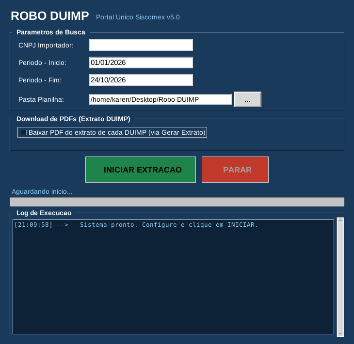

# Robô DUIMP

  

Automação para extração de dados e extratos das Declarações Únicas de Importação (DUIMP) no Portal Único Siscomex.

## Problema

Trading importadora de pneus que precisa emitir, trimestralmente, o relatório de redestinação exigido pelo IBAMA, com peso total importado, CNPJ do encomendante, NCMs, data de registro e o extrato em PDF de cada DUIMP do período. O levantamento era feito manualmente, declaração por declaração, e demandava tempo considerável em razão do volume de operações.

## Lógica

- **Entrada mínima.** O usuário informa apenas o CNPJ e o período de consulta.
- **Acesso seguro.** O login no portal é feito pelo próprio usuário, com o seu certificado digital. O robô não armazena nem digita senhas.
- **Coleta completa em uma única execução.** O robô percorre todas as DUIMPs do período, lê os dados necessários ao relatório e salva o extrato em PDF de cada declaração em uma pasta.
- **Saída pronta para o relatório.** Os dados são consolidados em uma planilha Excel, com uma linha por DUIMP e uma aba de resumo.
- **Tolerância a falhas.** Cada declaração é processada de forma independente: uma falha é registrada e a execução continua.

## Tecnologias

Python, Selenium, Tkinter, openpyxl e expressões regulares.
